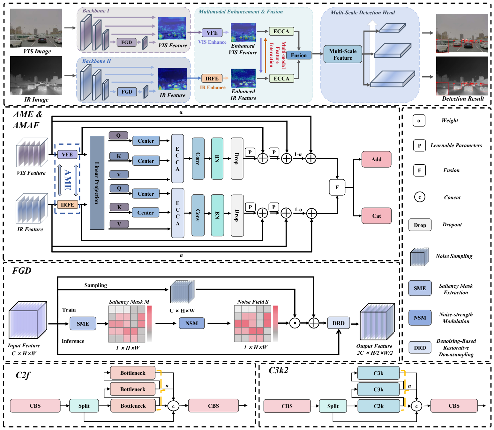
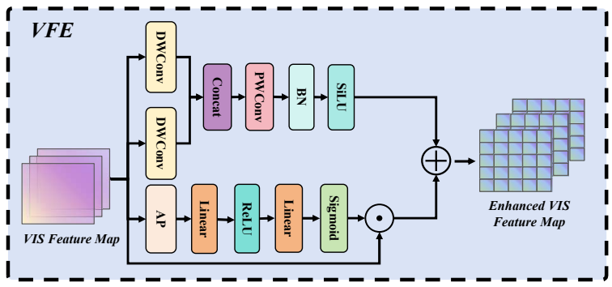
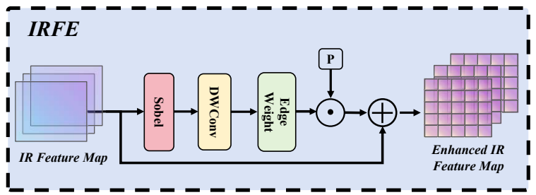

# A2IMDet

**Asymmetric and Adaptive Information-Preserving Multispectral Detection Framework**

RGB-IR object detection.

## Architecture



## Core Modules

- `modules/FGD.py`: Feature-Guided Denoising Downsampling.
- `modules/AME.py`: Asymmetric Modality Enhancement, including VFE and IRFE.
- `modules/AMAF.py`: Adaptive Modality-Aware Fusion with ECCA.




## Requirements

Requires PyTorch (`pip install -r requirements.txt`).

## Experimental Settings

Training settings reported in the paper:

| Dataset | Epochs | Batch size | Input resolution |
| --- | ---: | ---: | --- |
| FLIR | 100 | 8 | 640 x 640 |
| LLVIP | 40 | 8 | 640 x 640 |
| M3FD | 200 | 8 | 640 x 640 |
| MFAD | 120 | 8 | 640 x 640 |

All models are trained from scratch without pretrained weights. The initial learning rate is 0.01, decaying to 0.0001, with momentum 0.8. Experiments use PyTorch on a single NVIDIA A100 GPU. 

## Citation

If this work is useful in your research, please cite:

```bibtex
@ARTICLE{11667721,
  author={Liu, Jiaming and Zhuang, Yaoming and Chen, Weijia and Sun, Desheng and Fang, Zirui and Ma, Longyu and Li, Li and Wu, Chengdong and Liu, Zhanlin and Wu, Hao},
  journal={IEEE Transactions on Circuits and Systems for Video Technology},
  title={A2IMDet: Asymmetric and Adaptive Information-Preserving Multispectral Detection Framework},
  year={2026},
  volume={},
  number={},
  pages={1-1},
  doi={10.1109/TCSVT.2026.3727899}}
```

## License and Acknowledgments

The code retains the source project's AGPL-3.0 license; see [LICENSE](LICENSE). We thank the Ultralytics, DEYOLO, and EI2Det teams for their open-source contributions.
